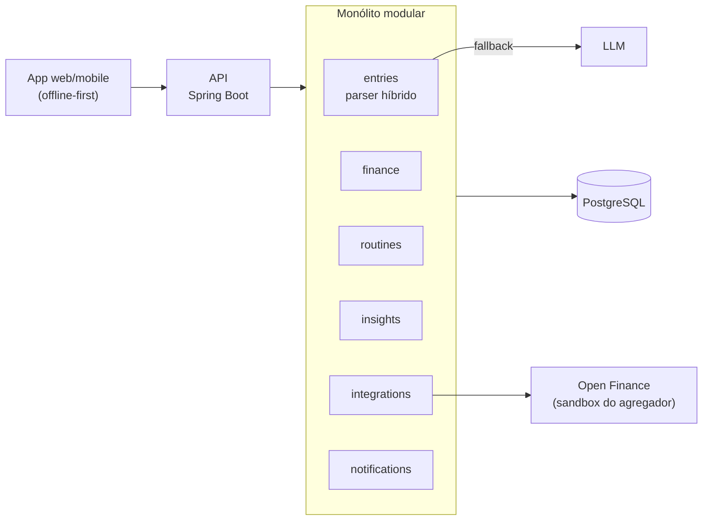

# MyDly

> Controle de rotinas e finanças com lançamento em linguagem natural.

Você escreve como falaria — **"Gastei 50 reais de energético na farmácia"**, **"50 reais"**, **"Fui à academia"**, **"Bebi 2 litros de água"** — e o MyDly entende se é um gasto ou um hábito, organiza os dados e devolve estatísticas, incentivos e, quando necessário, umas broncas.

> **Status:** em arquitetura. Este repositório é um projeto de portfólio e registra as decisões técnicas desde o início em [`docs/adr/`](docs/adr/).

## A ideia

| Você digita | O MyDly entende |
| --- | --- |
| `Gastei 50 reais comprando energético na farmácia` | Finança · R$ 50,00 · farmácia · energético |
| `50 reais` | Finança · R$ 50,00 · sem categoria (pergunta depois) |
| `Estudei durante 2 horas` | Rotina · estudo · 2 h |
| `Bebi 2 litros de água` | Rotina · hidratação · 2 L |
| `Dormi bem` | Rotina · sono · positivo |
| `Fui à academia e gastei 30 no açaí` | Dois lançamentos: rotina + finança |

O diferencial é **cruzar rotina e finanças**: "nos dias em que você dormiu mal, gastou 40% mais com delivery".

## Arquitetura



Detalhes em [`docs/arquitetura.md`](docs/arquitetura.md).

## Estrutura do repositório

```
mydly/
├── backend/            # API Java + Spring Boot (monólito modular)
├── frontend/           # App web e mobile
├── docs/
│   ├── arquitetura.md  # visão geral, módulos e modelo de dados
│   └── adr/            # Architecture Decision Records
├── docker-compose.yml  # infraestrutura local
└── .env.example
```

## Rodando localmente

Por enquanto o `docker-compose` sobe só o PostgreSQL. Backend e frontend entram no compose assim que forem criados.

```bash
cp .env.example .env
docker compose up -d
```

## Roadmap

- [ ] **MVP** — campo único de lançamento, parser híbrido, finanças e hábitos básicos, streaks, painel simples
- [ ] **v2** — metas, insights cruzados, escolha de tom (gentil / direto / bronca), notificações, importação de extrato OFX/CSV
- [ ] **v3** — Open Finance via sandbox, reconciliação automática, consultas conversacionais

## Decisões de arquitetura

| ADR | Decisão |
| --- | --- |
| [0001](docs/adr/0001-registrar-decisoes-com-adr.md) | Registrar decisões com ADRs |
| [0002](docs/adr/0002-monolito-modular.md) | Monólito modular em vez de microsserviços |
| [0003](docs/adr/0003-parser-hibrido.md) | Parser híbrido: regras locais + LLM como fallback |
| [0004](docs/adr/0004-stack-tecnologica.md) | Stack tecnológica |
| [0005](docs/adr/0005-integracoes-porta-adaptador.md) | Fontes de transação via porta/adaptador |
