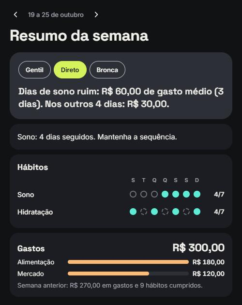
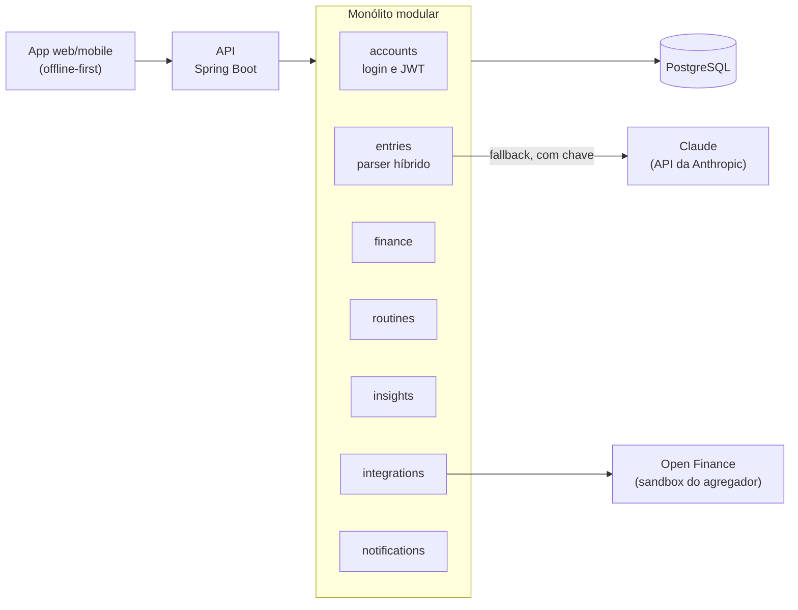

# MyDly

[](https://github.com/GabrieliModollo/mydly/actions/workflows/ci.yml)

> Controle de rotinas e finanças com lançamento em linguagem natural.

Você escreve como falaria — **"Gastei 50 reais de energético na farmácia"**, **"50 reais"**, **"Fui à academia"**, **"Bebi 2 litros de água"** — e o MyDly entende se é um gasto ou um hábito, organiza os dados e devolve estatísticas, incentivos e, quando necessário, umas broncas.

> **Status:** em desenvolvimento. Já dá para lançar pelo app e ver o que o MyDly entendeu. Este repositório é um projeto de portfólio e registra as decisões técnicas desde o início em [`docs/adr/`](docs/adr/).

<p align="center">
  
  
</p>

## A ideia

| Você digita | O MyDly entende |
| --- | --- |
| `Gastei 50 reais comprando energético na farmácia` | Finança · R$ 50,00 · farmácia · energético |
| `50 reais` | Finança · R$ 50,00 · sem categoria (pergunta depois) |
| `Estudei durante 2 horas` | Rotina · estudo · 2 h |
| `Bebi 2 litros de água` | Rotina · hidratação · 2 L |
| `Dormi bem` | Rotina · sono · positivo |
| `Fui à academia e gastei 30 no açaí` | Dois lançamentos: rotina + finança |

O diferencial é **cruzar rotina e finanças**: "nos dias em que você dormiu mal, gastou 40% mais com delivery".

## Arquitetura



Detalhes em [`docs/arquitetura.md`](docs/arquitetura.md). As regras de interpretação dos lançamentos estão em [`docs/parser.md`](docs/parser.md).

## Estrutura do repositório

```
mydly/
├── backend/            # API Java 21 + Spring Boot (monólito modular)
├── frontend/           # App Angular + Ionic/Capacitor (web e mobile)
├── .github/            # CI (GitHub Actions) e Dependabot
├── docs/
│   ├── arquitetura.md  # visão geral, módulos e modelo de dados
│   ├── parser.md       # regras e confianças do parser de lançamentos
│   ├── backlog.md      # próximas etapas, em ordem de prioridade
│   ├── design.md       # identidade visual e telas do app
│   ├── images/         # prints do app
│   └── adr/            # Architecture Decision Records
├── docker-compose.yml  # infraestrutura local
└── .env.example
```

## Rodando localmente

Requisito: Docker. O `docker-compose` sobe o PostgreSQL, o backend e o app.

```bash
cp .env.example .env
docker compose up --build
```

Abra o app em <http://localhost:8100> e toque em **Entrar na demonstração** (usuário `demo`, senha `demo`). Os dados da demonstração são compartilhados, então não escreva nada pessoal. Depois escreva, por exemplo, "50 reais" ou "bebi 2 litros de água". O lançamento aparece na lista com o que o MyDly entendeu. Quando ele não tem certeza ("Comprei pão", sem valor), o item mostra "Quanto foi? →", que abre um painel para você informar o valor e a categoria ou dizer que não foi um gasto. Uma frase como "Fui à academia e gastei 30 no açaí" vira dois itens, cada um na sua linha. Os cartões "Gasto hoje" e "Hábitos cumpridos" vêm dos módulos de finanças e hábitos: "Não comi besteira" conta como hábito cumprido, e "Tomei 2 energéticos" aparece como deslize. Se o MyDly entender algo errado, toque em "Não foi isso" para tirar o item dos números e corrigir. Na aba **Resumo**, a semana aparece com os hábitos dia a dia, os gastos por categoria e uma mensagem no tom que você escolher (Gentil, Direto ou Bronca), inclusive o cruzamento de sono e gastos quando há dias suficientes para ele não ser acaso. Na aba **Metas**, você define uma meta por hábito (2 L de água por dia, academia 4 dias por semana ou, num hábito para evitar, delivery no máximo 2 dias), um limite de gasto por categoria (por semana ou por mês) e o dia em que a sua semana começa. O Hoje mostra o progresso das metas do dia ("Hidratação 1,5 / 2 L") e avisa quando uma categoria chega a 80% do limite; o Resumo compara a semana com a meta ("3 de 4") e marca o limite nas barras de gasto. Mudar uma meta vale de hoje em diante: os dias que já passaram continuam com a meta que valia neles. Sem internet, o lançamento fica guardado no aparelho ("Guardado no aparelho.") e é enviado sozinho quando a conexão volta, com a data e a hora em que você escreveu, mesmo que o app tenha sido fechado no meio.

Na aba **Metas**, o link **Importar extrato** recebe o extrato do banco em OFX ou CSV. Cada transação entra nos seus números uma vez só: o que você já lançou no app (mesmo valor, de um dia antes a três dias depois) fica ligado ao lançamento e não conta duas vezes, e importar o mesmo arquivo de novo não duplica nada. Uma transferência entre contas suas pode ser marcada como "Não contar" ([ADR 0014](docs/adr/0014-importacao-de-extrato-e-reconciliacao.md)).

Por padrão, o parser usa só regras locais, e o que elas não entendem vira uma pergunta. Para que o Claude interprete essas frases ("gastei cinquenta reais na padaria"), defina `LLM_API_KEY` no `.env` com uma chave da API da Anthropic. Só o texto dos lançamentos duvidosos é enviado ([ADR 0013](docs/adr/0013-llm-de-fallback-com-claude.md)).

Saúde da API: <http://localhost:8080/actuator/health>. Para desenvolver fora dos containers, veja [`backend/README.md`](backend/README.md) e [`frontend/README.md`](frontend/README.md).

### Testando a API

Com a aplicação rodando, abra o Swagger UI em <http://localhost:8080/swagger-ui.html>. A API pede login: em **Login → POST /api/v1/auth/login**, envie o exemplo "Demonstração", copie o `accessToken` da resposta e cole no botão **Authorize**. Depois, em **Lançamentos → POST /api/v1/entries**, clique em *Try it out*, escolha um dos exemplos ("Gasto", "Rotina com quantidade", "Precisa de confirmação"...) e envie. A resposta traz o que o parser entendeu e se o app precisa confirmar com o usuário.

Pelo terminal:

```bash
TOKEN=$(curl -s -X POST http://localhost:8080/api/v1/auth/login \
  -H "Content-Type: application/json" \
  -d '{"username": "demo", "password": "demo"}' | sed 's/.*"accessToken":"\([^"]*\)".*/\1/')

curl -X POST http://localhost:8080/api/v1/entries \
  -H "Authorization: Bearer $TOKEN" \
  -H "Content-Type: application/json" \
  -d '{"text": "Gastei 50 reais na farmácia"}'
```

## Roadmap

O detalhamento e a prioridade de cada etapa estão em [`docs/backlog.md`](docs/backlog.md).

- [ ] **MVP** — campo único de lançamento, parser híbrido, finanças e hábitos básicos, streaks, painel simples
- [ ] **v2** — metas, insights cruzados, escolha de tom (gentil / direto / bronca), notificações, importação de extrato OFX/CSV
- [ ] **v3** — Open Finance via sandbox, reconciliação automática, consultas conversacionais

## Decisões de arquitetura

| ADR | Decisão |
| --- | --- |
| [0001](docs/adr/0001-registrar-decisoes-com-adr.md) | Registrar decisões com ADRs |
| [0002](docs/adr/0002-monolito-modular.md) | Monólito modular em vez de microsserviços |
| [0003](docs/adr/0003-parser-hibrido.md) | Parser híbrido: regras locais + LLM como fallback |
| [0004](docs/adr/0004-stack-tecnologica.md) | Stack tecnológica |
| [0005](docs/adr/0005-integracoes-porta-adaptador.md) | Fontes de transação via porta/adaptador |
| [0006](docs/adr/0006-id-do-cliente-e-occurred-at.md) | Id gerado pelo cliente e data do lançamento |
| [0007](docs/adr/0007-parse-e-resolucao-separados.md) | Interpretação do parser e resolução do usuário guardadas separadamente |
| [0008](docs/adr/0008-eventos-com-registro-e-revisao-por-item.md) | Eventos entre módulos com registro de publicação, revisão por item e reabertura |
| [0009](docs/adr/0009-mensagens-da-semana-por-regras.md) | Mensagens da semana por regras locais, com limiar contra o acaso |
| [0010](docs/adr/0010-metas-e-orcamentos-versionados.md) | Metas e orçamentos versionados com `valid_from`, avaliados no dia de referência |
| [0011](docs/adr/0011-fila-offline-no-aparelho.md) | Fila offline no aparelho, com envio em ordem e sem interpretação local |
| [0012](docs/adr/0012-login-com-jwt-e-dados-por-usuario.md) | Login com JWT emitido pela própria API e dados separados por usuário |
| [0013](docs/adr/0013-llm-de-fallback-com-claude.md) | LLM de fallback com o Claude, só para o que as regras não entenderam |
| [0014](docs/adr/0014-importacao-de-extrato-e-reconciliacao.md) | Importação de extrato OFX e CSV, com reconciliação nos dois sentidos |
