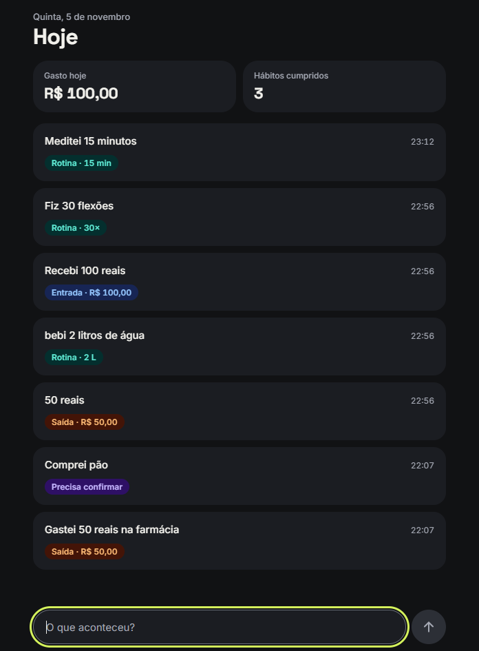
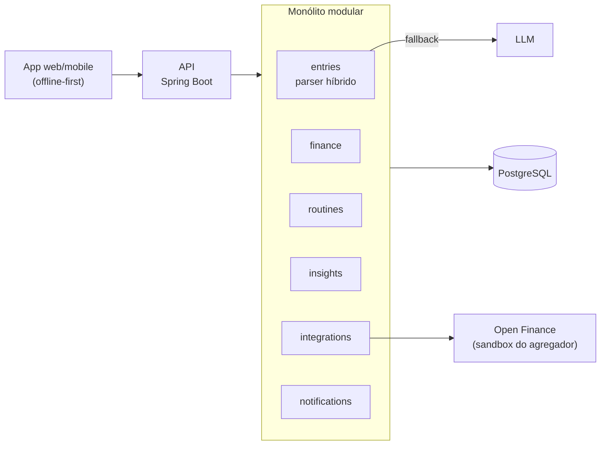

# MyDly

[](https://github.com/GabrieliModollo/mydly/actions/workflows/ci.yml)

> Controle de rotinas e finanças com lançamento em linguagem natural.

Você escreve como falaria — **"Gastei 50 reais de energético na farmácia"**, **"50 reais"**, **"Fui à academia"**, **"Bebi 2 litros de água"** — e o MyDly entende se é um gasto ou um hábito, organiza os dados e devolve estatísticas, incentivos e, quando necessário, umas broncas.

> **Status:** em desenvolvimento. Já dá para lançar pelo app e ver o que o MyDly entendeu. Este repositório é um projeto de portfólio e registra as decisões técnicas desde o início em [`docs/adr/`](docs/adr/).

<p align="center">
  
</p>

## A ideia

| Você digita | O MyDly entende |
| --- | --- |
| `Gastei 50 reais comprando energético na farmácia` | Finança · R$ 50,00 · farmácia · energético |
| `50 reais` | Finança · R$ 50,00 · sem categoria (pergunta depois) |
| `Estudei durante 2 horas` | Rotina · estudo · 2 h |
| `Bebi 2 litros de água` | Rotina · hidratação · 2 L |
| `Dormi bem` | Rotina · sono · positivo |
| `Fui à academia e gastei 30 no açaí` | Dois lançamentos: rotina + finança |

O diferencial é **cruzar rotina e finanças**: "nos dias em que você dormiu mal, gastou 40% mais com delivery".

## Arquitetura



Detalhes em [`docs/arquitetura.md`](docs/arquitetura.md). As regras de interpretação dos lançamentos estão em [`docs/parser.md`](docs/parser.md).

## Estrutura do repositório

```
mydly/
├── backend/            # API Java 21 + Spring Boot (monólito modular)
├── frontend/           # App Angular + Ionic/Capacitor (web e mobile)
├── .github/            # CI (GitHub Actions) e Dependabot
├── docs/
│   ├── arquitetura.md  # visão geral, módulos e modelo de dados
│   ├── parser.md       # regras e confianças do parser de lançamentos
│   ├── backlog.md      # próximas etapas, em ordem de prioridade
│   ├── design.md       # identidade visual e telas do app
│   ├── images/         # prints do app
│   └── adr/            # Architecture Decision Records
├── docker-compose.yml  # infraestrutura local
└── .env.example
```

## Rodando localmente

Requisito: Docker. O `docker-compose` sobe o PostgreSQL, o backend e o app.

```bash
cp .env.example .env
docker compose up --build
```

Abra o app em <http://localhost:8100> e escreva, por exemplo, "50 reais" ou "bebi 2 litros de água". O lançamento aparece na lista com o que o MyDly entendeu. Quando ele não tem certeza ("Comprei pão", sem valor), o item mostra "Quanto foi? →", que abre um painel para você informar o valor e a categoria ou dizer que não foi um gasto. Uma frase como "Fui à academia e gastei 30 no açaí" vira dois itens, cada um na sua linha.

Saúde da API: <http://localhost:8080/actuator/health>. Para desenvolver fora dos containers, veja [`backend/README.md`](backend/README.md) e [`frontend/README.md`](frontend/README.md).

### Testando a API

Com a aplicação rodando, abra o Swagger UI em <http://localhost:8080/swagger-ui.html>. Em **Lançamentos → POST /api/v1/entries**, clique em *Try it out*, escolha um dos exemplos ("Gasto", "Rotina com quantidade", "Precisa de confirmação"...) e envie. A resposta traz o que o parser entendeu e se o app precisa confirmar com o usuário.

Pelo terminal:

```bash
curl -X POST http://localhost:8080/api/v1/entries \
  -H "Content-Type: application/json" \
  -d '{"text": "Gastei 50 reais na farmácia"}'
```

## Roadmap

O detalhamento e a prioridade de cada etapa estão em [`docs/backlog.md`](docs/backlog.md).

- [ ] **MVP** — campo único de lançamento, parser híbrido, finanças e hábitos básicos, streaks, painel simples
- [ ] **v2** — metas, insights cruzados, escolha de tom (gentil / direto / bronca), notificações, importação de extrato OFX/CSV
- [ ] **v3** — Open Finance via sandbox, reconciliação automática, consultas conversacionais

## Decisões de arquitetura

| ADR | Decisão |
| --- | --- |
| [0001](docs/adr/0001-registrar-decisoes-com-adr.md) | Registrar decisões com ADRs |
| [0002](docs/adr/0002-monolito-modular.md) | Monólito modular em vez de microsserviços |
| [0003](docs/adr/0003-parser-hibrido.md) | Parser híbrido: regras locais + LLM como fallback |
| [0004](docs/adr/0004-stack-tecnologica.md) | Stack tecnológica |
| [0005](docs/adr/0005-integracoes-porta-adaptador.md) | Fontes de transação via porta/adaptador |
| [0006](docs/adr/0006-id-do-cliente-e-occurred-at.md) | Id gerado pelo cliente e data do lançamento |
| [0007](docs/adr/0007-parse-e-resolucao-separados.md) | Interpretação do parser e resolução do usuário guardadas separadamente |
