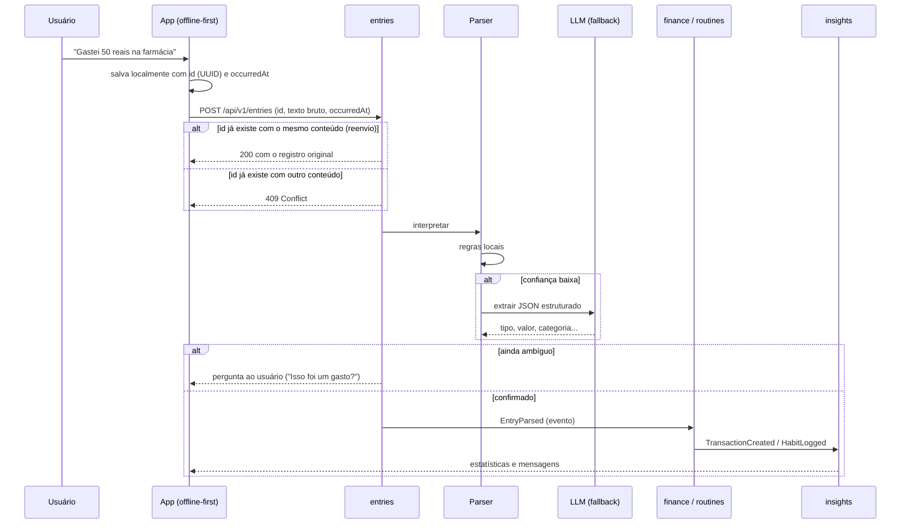
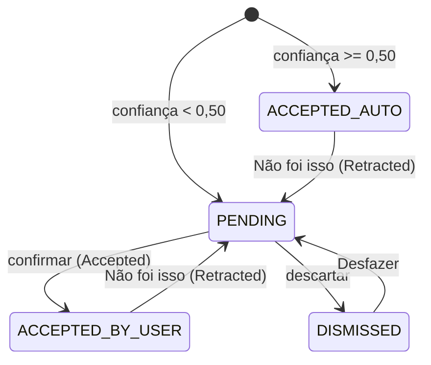
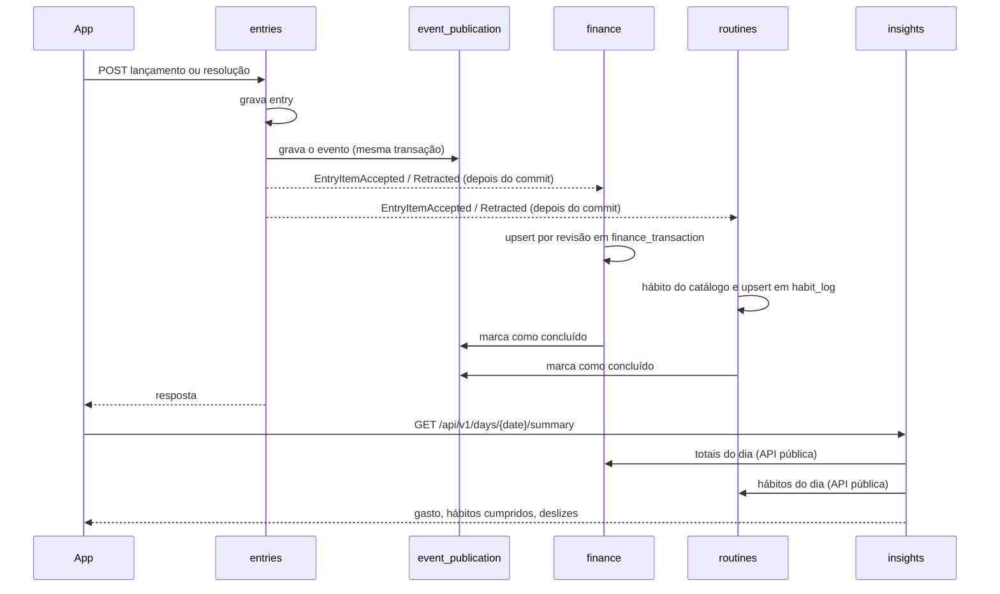
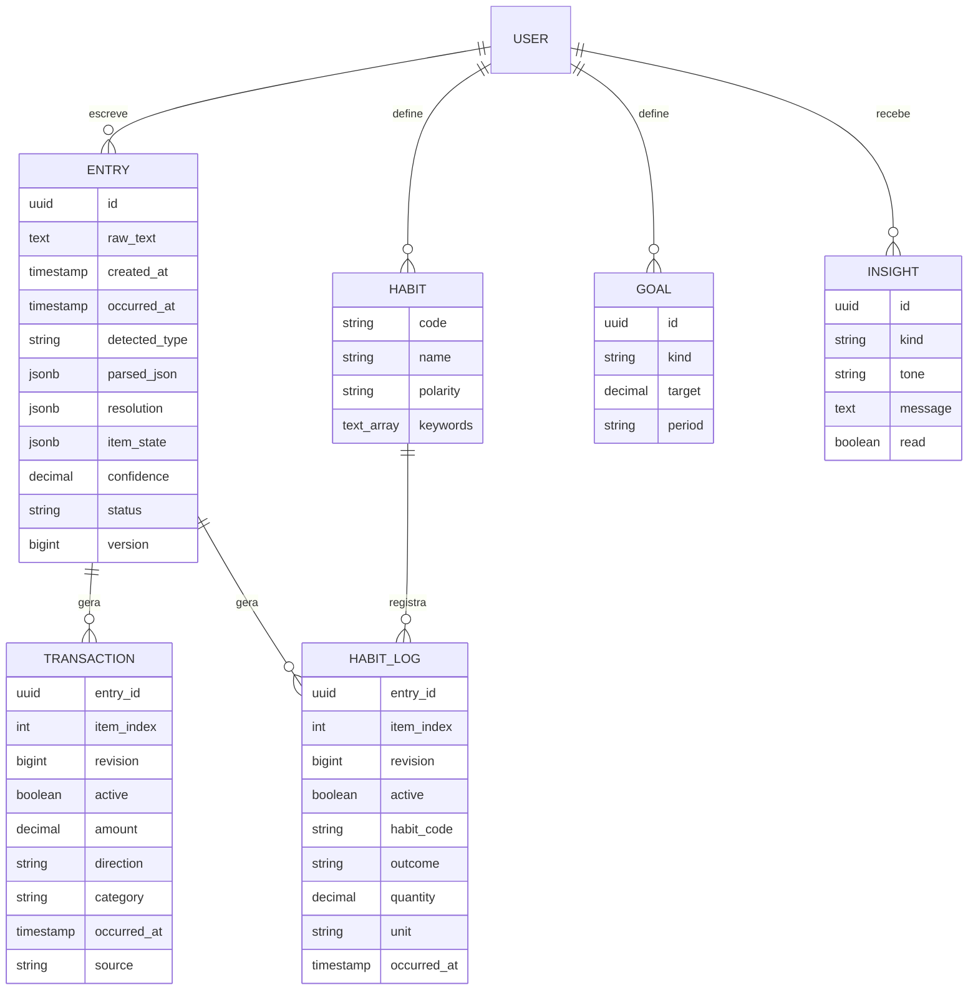
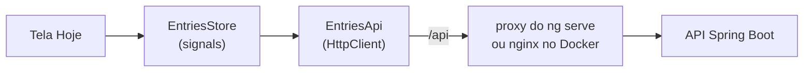

# Arquitetura do MyDly

## Visão geral

O MyDly é um **monólito modular** em Java + Spring Boot, com um app web e mobile que funciona offline e sincroniza depois. Cada módulo tem fronteira própria e se comunica com os outros por eventos de domínio, o que permite extrair um módulo para um serviço separado no futuro sem reescrever o resto.

## Fluxo de um lançamento

As regras locais do parser, com as faixas de confiança e o limiar a partir do qual o app pergunta ao usuário, estão em [`parser.md`](parser.md).

**O que já está implementado.** O `POST /api/v1/entries` recebe o lançamento, interpreta com as regras locais e grava na tabela `entry`. Ele é idempotente pelo id enviado pelo app: o reenvio do mesmo conteúdo devolve o original, e o mesmo id com outro conteúdo devolve 409 ([ADR 0006](adr/0006-id-do-cliente-e-occurred-at.md)). A resposta da API usa DTOs próprios, separados do formato gravado no `parsed_json`. Uma frase composta ("fui à academia e gastei 30 no açaí") vira vários itens no mesmo lançamento, até 5, cada um com o seu trecho do texto ([regras](parser.md#frases-compostas)).

Cada item tem um estado ([ADR 0008](adr/0008-eventos-com-registro-e-revisao-por-item.md)). Um item com confiança de 0,50 para cima vale na hora e segue para `finance` ou `routines`. Um item abaixo disso espera o usuário no painel "Quanto foi?" (`POST /api/v1/entries/{id}/items/{index}/resolution`, com `If-Match`), onde ele confirma como gasto, entrada ou rotina, ou descarta. A resposta fica na coluna `resolution`, sem sobrescrever o que o parser entendeu ([ADR 0007](adr/0007-parse-e-resolucao-separados.md)). Todo item aceito pode voltar com "Não foi isso" (ação `REOPEN`): ele sai dos números e o painel abre para corrigir. O lançamento fica `NEEDS_INPUT` enquanto algum item estiver pendente e `CONFIRMED` quando nenhum estiver. O fallback para o LLM entra numa próxima etapa. A API pode ser testada pelo Swagger UI em `/swagger-ui.html`.

## Eventos entre módulos

`entries` publica `EntryItemAccepted` quando um item passa a valer e `EntryItemRetracted` quando um item que valia é reaberto. Os dois levam a revisão do item. O registro de publicação do Spring Modulith grava cada evento na mesma transação do lançamento e reenvia, ao subir a aplicação, os que ficaram sem concluir ([ADR 0008](adr/0008-eventos-com-registro-e-revisao-por-item.md)).

- **Ordem e repetição.** Um evento só vale se a revisão for maior que a gravada, numa única instrução SQL. Retirada vira lápide (`active = false`), nunca `DELETE`, para que uma aceitação antiga atrasada não ressuscite o item.
- **Hábitos.** O módulo `routines` encontra o hábito do catálogo pelas palavras-chave e aplica a polaridade: hábito ruim evitado ("Não comi besteira") conta como cumprido, e hábito ruim consumido ("Tomei 2 energéticos") é deslize. Rotina fora do catálogo fica como "outros", fora dos indicadores.
- **Resumo do dia.** O `GET /api/v1/days/{date}/summary`, no módulo `insights`, só lê as APIs públicas de `finance` (`FinanceTotals`) e `routines` (`HabitOutcomes`), no fuso `America/Sao_Paulo`.
- **Histórico.** Os lançamentos anteriores à etapa 5 entraram por um backfill que roda uma vez só e pode ser repetido sem duplicar.
- **Falhas.** Se um consumidor falhar, uma nova tentativa agendada reenvia o evento em cerca de um minuto, e o `/actuator/health` fica `OUT_OF_SERVICE` se um evento passar de dez minutos sem concluir.

## Módulos

| Módulo | Responsabilidade |
| --- | --- |
| `entries` | Recebe o texto bruto, guarda sempre o original e coordena a interpretação |
| `finance` | Transações, categorias, orçamentos |
| `routines` | Hábitos, registros diários, metas |
| `insights` | Estatísticas, streaks, cruzamentos rotina × finanças, mensagens |
| `integrations` | Fontes externas de transação (extrato, Open Finance) e reconciliação |
| `notifications` | Push e lembretes |

## Modelo de dados (núcleo)

- `Entry.raw_text` nunca é descartado: quando o parser melhorar, os lançamentos antigos podem ser reprocessados.
- `Entry.occurred_at` é quando o usuário escreveu, informado pelo app; `created_at` é quando o servidor gravou ([ADR 0006](adr/0006-id-do-cliente-e-occurred-at.md)).
- `Entry.parsed_json` guarda a lista de itens interpretados; `detected_type` é o tipo comum a todos (ou vazio se forem mistos ou desconhecidos) e `confidence` é a menor entre eles.
- `Entry.resolution` guarda as respostas do usuário, alinhadas com os itens, e `Entry.version` faz o controle de concorrência (ETag). O valor efetivo de um item é a resolução, quando existe ([ADR 0007](adr/0007-parse-e-resolucao-separados.md)).
- `Entry.item_state` guarda o estado e a revisão de cada item ([ADR 0008](adr/0008-eventos-com-registro-e-revisao-por-item.md)).
- `TRANSACTION` é a tabela `finance_transaction`, e ela e `HABIT_LOG` têm uma linha por item de lançamento (`entry_id` + `item_index`), com `revision` e `active` para aplicar os eventos na ordem certa.
- `Habit.polarity` diferencia hábitos bons ("dormi bem") de ruins ("pedi delivery 3x"). Por enquanto o catálogo é fixo, criado por migração; hábitos do usuário, alvos e metas (`USER`, `GOAL`) entram depois.
- `Transaction.source` registra a origem (`MANUAL`, `STATEMENT_IMPORT`, `OPEN_FINANCE`) e é a base da reconciliação.

## App (frontend)

Angular 22 + Ionic 9 + Capacitor 8 em `frontend/`, com componentes standalone e estado em signals, sem zone.js. Detalhes em [`frontend/README.md`](../frontend/README.md).

- **Mesma origem.** O app chama `/api/...`. No desenvolvimento, o proxy do `ng serve` encaminha ao `localhost:8080`; no `docker compose`, o nginx que serve o app encaminha ao backend. Não há CORS.
- **Envio otimista.** O lançamento aparece na lista como "Enviando…" com o id e a data gerados no app. Se a rede falhar, o reenvio usa o mesmo id, e a API não duplica ([ADR 0006](adr/0006-id-do-cliente-e-occurred-at.md)).
- **Listagem do dia.** O `GET /api/v1/entries?date=AAAA-MM-DD` filtra pelo `occurred_at` no fuso `America/Sao_Paulo`, até existir fuso por usuário. Sem `date`, vale hoje.
- **Próximo passo:** a fila offline, que guarda os lançamentos no aparelho enquanto não há rede.

## Privacidade (LGPD)

O app guarda dados financeiros e dados que podem ser de saúde (sono, dieta). Por isso:

- consentimento explícito no cadastro;
- criptografia dos campos sensíveis em repouso;
- exportação e exclusão de conta;
- só o texto do lançamento vai para o LLM, sem identificar o usuário;
- a fonte do app é servida por ele mesmo, sem chamadas a serviços de terceiros como o Google Fonts.
