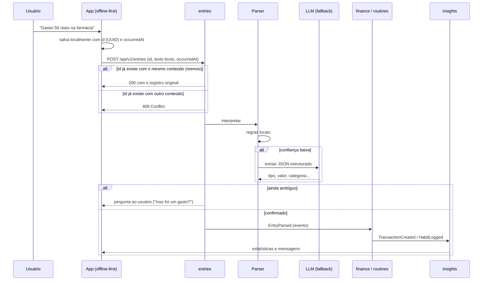
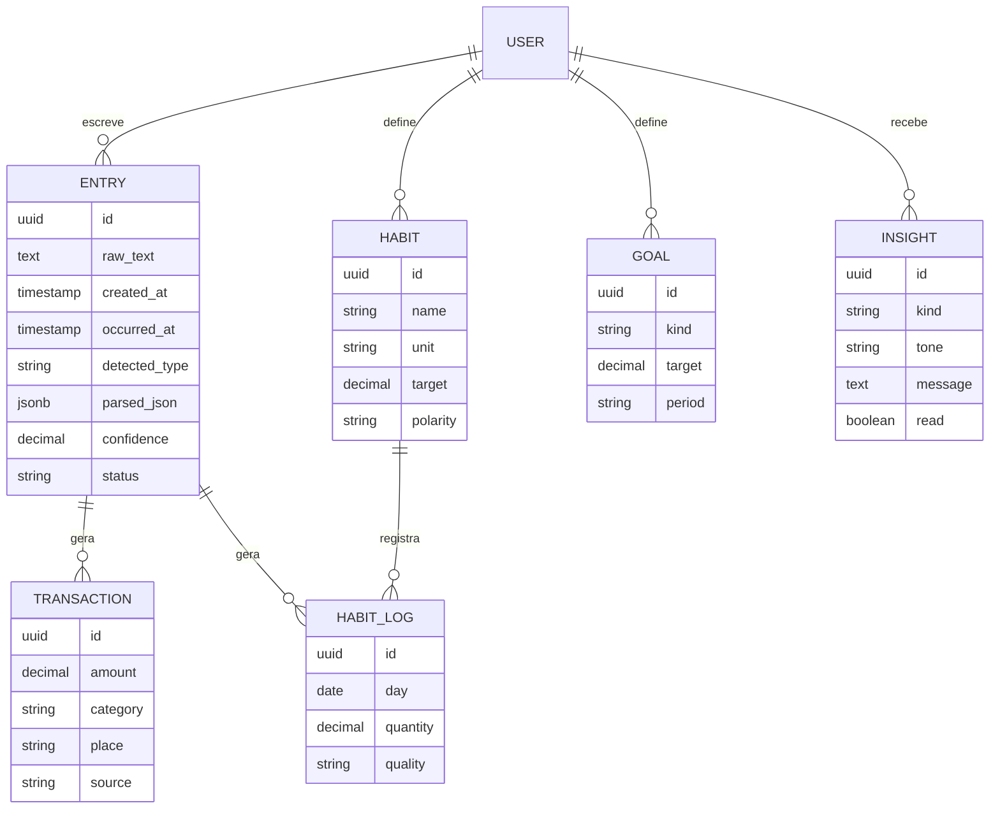

# Arquitetura do MyDly

## Visão geral

O MyDly é um **monólito modular** em Java + Spring Boot, com um app web e mobile que funciona offline e sincroniza depois. Cada módulo tem fronteira própria e se comunica com os outros por eventos de domínio, o que permite extrair um módulo para um serviço separado no futuro sem reescrever o resto.

## Fluxo de um lançamento

As regras locais do parser, com as faixas de confiança e o limiar a partir do qual o app pergunta ao usuário, estão em [`parser.md`](parser.md).

**O que já está implementado.** O `POST /api/v1/entries` recebe o lançamento, interpreta com as regras locais e grava na tabela `entry`. Ele é idempotente pelo id enviado pelo app: o reenvio do mesmo conteúdo devolve o original, e o mesmo id com outro conteúdo devolve 409 ([ADR 0006](adr/0006-id-do-cliente-e-occurred-at.md)). A resposta da API usa DTOs próprios, separados do formato gravado no `parsed_json`. O status fica `NEEDS_INPUT` quando algum item tem confiança abaixo de 0,50, e `PENDING` nos outros casos. O fallback para o LLM e os eventos para `finance` e `routines` entram nas próximas etapas. Os eventos vão entrar junto com o módulo `finance`, quando houver quem os consuma. A API pode ser testada pelo Swagger UI em `/swagger-ui.html`.

## Módulos

| Módulo | Responsabilidade |
| --- | --- |
| `entries` | Recebe o texto bruto, guarda sempre o original e coordena a interpretação |
| `finance` | Transações, categorias, orçamentos |
| `routines` | Hábitos, registros diários, metas |
| `insights` | Estatísticas, streaks, cruzamentos rotina × finanças, mensagens |
| `integrations` | Fontes externas de transação (extrato, Open Finance) e reconciliação |
| `notifications` | Push e lembretes |

## Modelo de dados (núcleo)

- `Entry.raw_text` nunca é descartado: quando o parser melhorar, os lançamentos antigos podem ser reprocessados.
- `Entry.occurred_at` é quando o usuário escreveu, informado pelo app; `created_at` é quando o servidor gravou ([ADR 0006](adr/0006-id-do-cliente-e-occurred-at.md)).
- `Entry.parsed_json` guarda a lista de itens interpretados; `detected_type` é o tipo comum a todos (ou vazio se forem mistos ou desconhecidos) e `confidence` é a menor entre eles.
- `Habit.polarity` diferencia hábitos bons ("dormi bem") de ruins ("pedi delivery 3x").
- `Transaction.source` registra a origem (`MANUAL`, `STATEMENT_IMPORT`, `OPEN_FINANCE`) e é a base da reconciliação.

## Privacidade (LGPD)

O app guarda dados financeiros e dados que podem ser de saúde (sono, dieta). Por isso:

- consentimento explícito no cadastro;
- criptografia dos campos sensíveis em repouso;
- exportação e exclusão de conta;
- só o texto do lançamento vai para o LLM, sem identificar o usuário.
