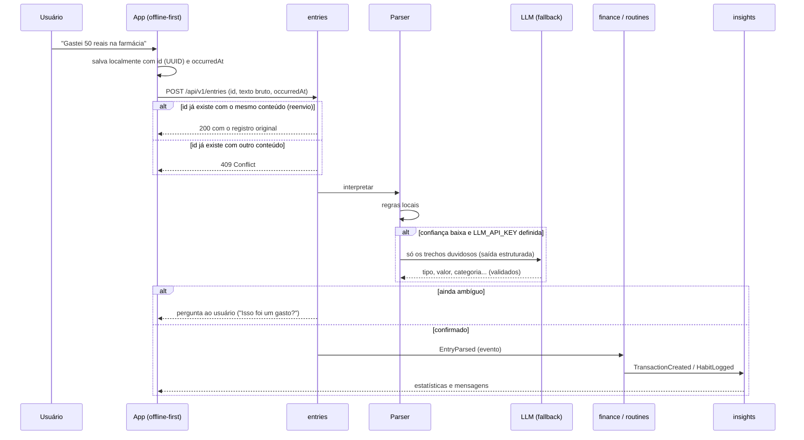
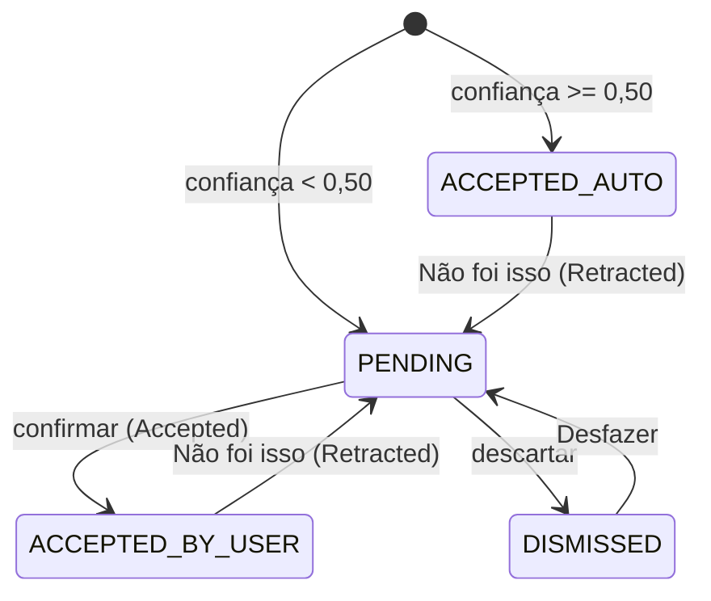
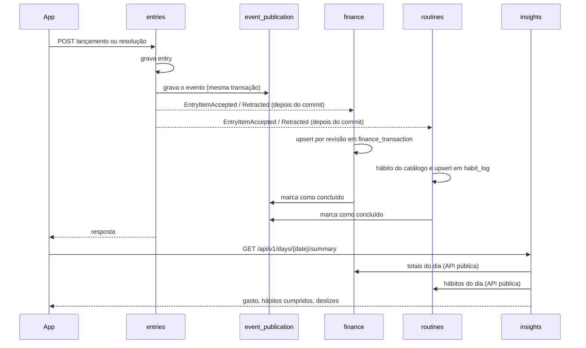
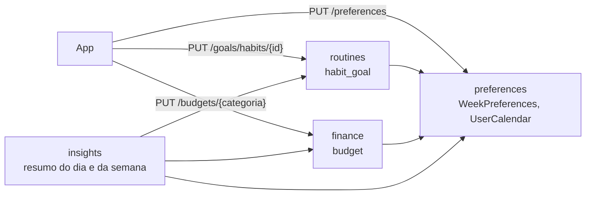
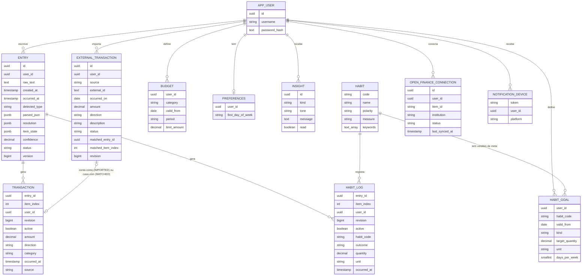
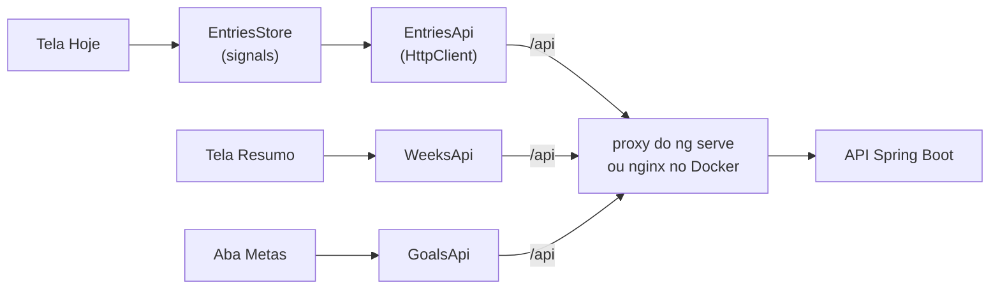

# Arquitetura do MyDly

## Visão geral

O MyDly é um **monólito modular** em Java + Spring Boot, com um app web e mobile que funciona offline e sincroniza depois. Cada módulo tem fronteira própria e se comunica com os outros por eventos de domínio, o que permite extrair um módulo para um serviço separado no futuro sem reescrever o resto.

Toda a API, menos o login e o cadastro, exige um token de acesso (JWT) emitido pela própria API, e cada dado tem dono: um usuário só vê e muda o que é seu ([ADR 0012](adr/0012-login-com-jwt-e-dados-por-usuario.md)). Qualquer pessoa cria uma conta, que começa vazia ([ADR 0018](adr/0018-cadastro-de-conta.md)).

## Fluxo de um lançamento

As regras locais do parser, com as faixas de confiança e o limiar a partir do qual o app pergunta ao usuário, estão em [`parser.md`](parser.md).

**O que já está implementado.** O `POST /api/v1/entries` recebe o lançamento, interpreta com as regras locais e grava na tabela `entry`. Ele é idempotente pelo id enviado pelo app: o reenvio do mesmo conteúdo devolve o original, e o mesmo id com outro conteúdo devolve 409 ([ADR 0006](adr/0006-id-do-cliente-e-occurred-at.md)). A resposta da API usa DTOs próprios, separados do formato gravado no `parsed_json`. Uma frase composta ("fui à academia e gastei 30 no açaí") vira vários itens no mesmo lançamento, até 5, cada um com o seu trecho do texto ([regras](parser.md#frases-compostas)).

Cada item tem um estado ([ADR 0008](adr/0008-eventos-com-registro-e-revisao-por-item.md)). Um item com confiança de 0,50 para cima vale na hora e segue para `finance` ou `routines`. Um item abaixo disso espera o usuário no painel "Quanto foi?" (`POST /api/v1/entries/{id}/items/{index}/resolution`, com `If-Match`), onde ele confirma como gasto, entrada ou rotina, ou descarta. A resposta fica na coluna `resolution`, sem sobrescrever o que o parser entendeu ([ADR 0007](adr/0007-parse-e-resolucao-separados.md)). Todo item aceito pode voltar com "Não foi isso" (ação `REOPEN`): ele sai dos números e o painel abre para corrigir. O lançamento fica `NEEDS_INPUT` enquanto algum item estiver pendente e `CONFIRMED` quando nenhum estiver. Antes de gravar, os itens abaixo do limiar vão para o LLM, quando há `LLM_API_KEY`: o Claude, pelo SDK oficial da Anthropic, com saída estruturada e só o texto do lançamento. A resposta é validada campo a campo, e qualquer falha deixa o item como as regras entenderam ([ADR 0013](adr/0013-llm-de-fallback-com-claude.md), [regras](parser.md#llm-de-fallback)). A API pode ser testada pelo Swagger UI em `/swagger-ui.html`.

## Eventos entre módulos

`entries` publica `EntryItemAccepted` quando um item passa a valer e `EntryItemRetracted` quando um item que valia é reaberto. Os dois levam a revisão do item. O registro de publicação do Spring Modulith grava cada evento na mesma transação do lançamento e reenvia, ao subir a aplicação, os que ficaram sem concluir ([ADR 0008](adr/0008-eventos-com-registro-e-revisao-por-item.md)).

- **Ordem e repetição.** Um evento só vale se a revisão for maior que a gravada, numa única instrução SQL. Retirada vira lápide (`active = false`), nunca `DELETE`, para que uma aceitação antiga atrasada não ressuscite o item.
- **Hábitos.** O módulo `routines` encontra o hábito do catálogo pelas palavras-chave e aplica a polaridade: hábito ruim evitado ("Não comi besteira") conta como cumprido, e hábito ruim consumido ("Tomei 2 energéticos") é deslize. Rotina fora do catálogo fica como "outros", fora dos indicadores. Quando nenhuma palavra-chave casa, a frase é só "bebi" com um volume (`L` ou `mL`) e não há complemento de bebida depois da quantidade, o item é Hidratação: "bebi 1 litro", "bebi 500ml" e "Bebi 2 litros hoje" contam como água, mas "bebi 1 litro de cerveja" e "bebi 500 ml de suco" ficam em "outros" (e "bebi 2 litros de refrigerante" já é Refrigerante pela palavra-chave). Só advérbios de tempo ("hoje", "agora", "no total") podem vir depois da quantidade.
- **Resumo do dia.** O `GET /api/v1/days/{date}/summary`, no módulo `insights`, só lê as APIs públicas de `finance` (`FinanceTotals`) e `routines` (`HabitOutcomes`), no fuso `America/Sao_Paulo`.
- **Histórico.** Os lançamentos anteriores à etapa 5 entraram por um backfill que roda uma vez só e pode ser repetido sem duplicar.
- **Falhas.** Se um consumidor falhar, uma nova tentativa agendada reenvia o evento em cerca de um minuto, e o `/actuator/health` fica `OUT_OF_SERVICE` se um evento passar de dez minutos sem concluir.

## Resumo da semana

O `GET /api/v1/weeks/{inicio}/summary?tone=gentle|direct|scold` (ou `/weeks/current/summary`), no módulo `insights`, monta a semana de 7 dias a partir do dia de início das preferências (segunda por padrão) no fuso `America/Sao_Paulo`. Ele traz os hábitos com os 7 dias (`ACHIEVED`, `SLIPPED`, `MISSED`, `NONE` ou `FUTURE`) e o placar `{ achieved, elapsedDays, target, limit, slips, goal }`, os gastos por categoria, os orçamentos, a comparação com os mesmos dias decorridos da semana anterior e até três mensagens no tom pedido. As mensagens saem de regras locais com limiar fixo, sem LLM ([ADR 0009](adr/0009-mensagens-da-semana-por-regras.md) e [ADR 0010](adr/0010-metas-e-orcamentos-versionados.md)). Como no resumo do dia, `insights` só lê as APIs públicas de `finance` (`FinanceTotals`, `Budgets`), `routines` (`HabitOutcomes`, `HabitGoals`) e `preferences` (`WeekPreferences`, `UserCalendar`).

## Metas, orçamentos e preferências

A etapa 7 ([ADR 0010](adr/0010-metas-e-orcamentos-versionados.md)) traz três coisas, cada uma no seu módulo:

| O quê | Módulo | Endpoints |
| --- | --- | --- |
| Dia de início da semana, global até existir usuário | `preferences` (folha, não depende de nenhum módulo) | `GET` e `PUT /api/v1/preferences` |
| Meta por hábito do catálogo: quantidade por dia (`DAILY_QUANTITY`, como 2 L) ou dias por semana (`WEEKLY_FREQUENCY`); num hábito ruim, um limite | `routines` | `GET /api/v1/goals/habits`; `GET`, `PUT` e `DELETE /api/v1/goals/habits/{habitId}` |
| Limite de gasto por categoria, semanal ou mensal, com aviso em 80% | `finance` | `GET /api/v1/budgets`; `GET`, `PUT` e `DELETE /api/v1/budgets/{category}` |

- **Versões com `valid_from`.** Metas e orçamentos nunca são sobrescritos: mudar grava uma versão a partir de hoje (em São Paulo, pelo `Clock` injetável), remover grava uma versão "sem meta", e duas gravações no mesmo dia ficam numa versão só (upsert). Cada dia é avaliado pela versão vigente nele.
- **Dia de referência.** A meta de dias por semana e o limite de uma semana são os da versão vigente no último dia dela, ou hoje se ela está em curso. A meta diária é avaliada dia a dia, cada um pela sua versão.
- **Unidades.** O catálogo tem a dimensão de medida de cada hábito (`VOLUME` na hidratação; `DURATION` no estudo, sono, leitura e academia). A meta diária só aceita unidade da mesma dimensão (`L` e `mL`, `h` e `min`), e a soma do dia é feita em `BigDecimal` na unidade base. "3 copos" e registros sem número não somam.
- **Onde aparece.** O resumo do dia traz o progresso das metas diárias (`dailyGoals`) e os alertas de orçamento (`budgetAlerts`, o único lugar com o alerta). O resumo da semana traz o placar contra a meta, os orçamentos (`budgets`) e as mensagens `BUDGET_OVER`, `GOAL_AT_RISK`, `BUDGET_NEAR` e `GOAL_MET`.
- **Troca do dia de início.** A semana é calculada na hora, então as semanas passadas também passam a seguir o dia novo. O `/weeks/{inicio}` valida a data contra o dia atual; o app navega pelas datas que a API devolve e volta para `/weeks/current` depois da troca.
- **Privacidade.** Valores de meta e de orçamento são valores: não vão para log, como o texto e o valor dos lançamentos.

## Módulos

| Módulo | Responsabilidade |
| --- | --- |
| `accounts` | Usuários, cadastro, login com senha, limite de tentativas e o token de acesso; diz aos controladores quem fez o pedido (`CurrentUser`) e publica o `DemoReset`, que cada módulo escuta para voltar o usuário demo ao exemplo |
| `entries` | Recebe o texto bruto, guarda sempre o original e coordena a interpretação, com a cota diária do LLM por usuário |
| `finance` | Transações, categorias, orçamentos |
| `routines` | Hábitos, registros diários, metas |
| `preferences` | Preferências do usuário (dia de início da semana) e o calendário dele (fuso e hoje) |
| `insights` | Estatísticas, streaks, cruzamentos rotina × finanças, mensagens |
| `integrations` | Fontes externas de transação atrás da porta `TransactionSource` (extrato OFX e CSV, e Open Finance pelo Pluggy só no sandbox) e reconciliação com os lançamentos manuais |
| `notifications` | Push pelo Firebase: alerta de orçamento, lembrete do dia e resumo da semana, em tarefas agendadas que só leem APIs públicas |

## Modelo de dados (núcleo)

- `Entry.raw_text` nunca é descartado: quando o parser melhorar, os lançamentos antigos podem ser reprocessados.
- `Entry.occurred_at` é quando o usuário escreveu, informado pelo app; `created_at` é quando o servidor gravou ([ADR 0006](adr/0006-id-do-cliente-e-occurred-at.md)).
- `Entry.parsed_json` guarda a lista de itens interpretados; `detected_type` é o tipo comum a todos (ou vazio se forem mistos ou desconhecidos) e `confidence` é a menor entre eles.
- `Entry.resolution` guarda as respostas do usuário, alinhadas com os itens, e `Entry.version` faz o controle de concorrência (ETag). O valor efetivo de um item é a resolução, quando existe ([ADR 0007](adr/0007-parse-e-resolucao-separados.md)).
- `Entry.item_state` guarda o estado e a revisão de cada item ([ADR 0008](adr/0008-eventos-com-registro-e-revisao-por-item.md)).
- `TRANSACTION` é a tabela `finance_transaction`, e ela e `HABIT_LOG` têm uma linha por item de lançamento (`entry_id` + `item_index`), com `revision` e `active` para aplicar os eventos na ordem certa.
- `Habit.polarity` diferencia hábitos bons ("dormi bem") de ruins ("pedi delivery 3x"), e `Habit.measure` diz se o hábito se mede em volume, em duração ou não se mede. Por enquanto o catálogo é fixo, criado por migração; hábitos do usuário (`USER`) entram depois.
- `APP_USER` é do módulo `accounts`, e as outras tabelas guardam o dono em `user_id`, sem chave estrangeira entre módulos. Os dados que existiam antes do login são do usuário `demo`, criado pela migração ([ADR 0012](adr/0012-login-com-jwt-e-dados-por-usuario.md)); as outras contas vêm do cadastro, com o nome único e em minúsculas ([ADR 0018](adr/0018-cadastro-de-conta.md)).
- `HABIT_GOAL` e `BUDGET` são versões: a chave é `(user_id, habit_code, valid_from)` e `(user_id, category, valid_from)`, e a versão vigente num dia é a de maior `valid_from` até ele. A versão de remoção tem `kind = NONE` na meta e período e limite nulos no orçamento ([ADR 0010](adr/0010-metas-e-orcamentos-versionados.md)).
- `PREFERENCES` tem uma linha por usuário, criada quando ele muda algo; sem linha, a semana começa na segunda.
- `Transaction.source` registra a origem (`MANUAL`, `STATEMENT_IMPORT`, `OPEN_FINANCE`). Uma transação importada que não casou com um lançamento conta como uma linha com `source = STATEMENT_IMPORT`, o id dela em `entry_id` e `item_index` zero.
- `EXTERNAL_TRANSACTION` é do módulo `integrations`: cada linha de extrato importada, única por usuário, origem e id externo, com o status `IMPORTED` (conta nos números), `MATCHED` (ligada ao lançamento manual em `matched_entry_id`, não conta de novo) ou `IGNORED`. A reconciliação acontece na importação e, no outro sentido, quando um lançamento é aceito ou retirado depois ([ADR 0014](adr/0014-importacao-de-extrato-e-reconciliacao.md)).
- `NOTIFICATION_DEVICE`, `notification_settings` e `notification_sent` são do módulo `notifications`: os aparelhos que recebem push (o token do Firebase é a chave, e passa para quem entrar no app por último), o que cada usuário quer receber e o que já foi enviado, para cada notificação sair uma vez só ([ADR 0016](adr/0016-apps-nativos-e-notificacoes-push.md)).
- `llm_usage` é do módulo `entries`: quantas chamadas ao LLM cada usuário fez em cada dia de São Paulo, para a cota diária. Guarda só a contagem ([ADR 0017](adr/0017-demonstracao-segura.md)).
- `OPEN_FINANCE_CONNECTION` é do módulo `integrations`: cada banco de teste conectado pelo Pluggy (o "item" dele), único no MyDly, com o status do item e a última sincronização. As transações dele entram por `EXTERNAL_TRANSACTION` com `source = OPEN_FINANCE` ([ADR 0015](adr/0015-open-finance-pelo-pluggy-so-sandbox.md)).

## App (frontend)

Angular 22 + Ionic 9 + Capacitor 8 em `frontend/`, com componentes standalone e estado em signals, sem zone.js. Detalhes em [`frontend/README.md`](../frontend/README.md).

- **App nativo.** O mesmo código vira os apps Android e iOS pelo Capacitor. Lá a página vem do aparelho, então um interceptador põe o endereço da API (`MYDLY_API_URL`, do build) na frente de `/api/...`, e a API aceita por CORS as origens `https://localhost` e `capacitor://localhost` ([ADR 0016](adr/0016-apps-nativos-e-notificacoes-push.md)).
- **Open Finance.** O app pede ao servidor um connect token e abre o widget do Pluggy, que fala direto com o banco de teste; o servidor recebe só o id do item, confere que é de sandbox e do mesmo usuário, e importa ([ADR 0015](adr/0015-open-finance-pelo-pluggy-so-sandbox.md)).
- **Login e cadastro.** A tela de login troca usuário e senha por um token, guardado no aparelho com a validade; a de cadastro (`/cadastro`) cria a conta e devolve o mesmo token, e a pessoa já entra ([ADR 0018](adr/0018-cadastro-de-conta.md)). Um interceptador põe o token em todo pedido à API, e um 401 encerra a sessão e leva ao login ([ADR 0012](adr/0012-login-com-jwt-e-dados-por-usuario.md)).
- **Mesma origem.** O app chama `/api/...`. No desenvolvimento, o proxy do `ng serve` encaminha ao `localhost:8080`; no `docker compose`, o nginx que serve o app encaminha ao backend. Não há CORS.
- **Envio otimista.** O lançamento aparece na lista como "Enviando…" com o id e a data gerados no app. Se a rede falhar, o reenvio usa o mesmo id, e a API não duplica ([ADR 0006](adr/0006-id-do-cliente-e-occurred-at.md)).
- **Fila offline.** Sem rede, ou com o servidor fora, o lançamento fica no `localStorage` do aparelho (`mydly.outbox.v1`) e é enviado quando a conexão volta, ao abrir o app e 30 segundos depois de uma falha, um por vez e do mais antigo ao mais novo. O parser continua só no servidor: um lançamento guardado aparece sem chips até ser enviado ([ADR 0011](adr/0011-fila-offline-no-aparelho.md)).
- **Listagem do dia.** O `GET /api/v1/entries?date=AAAA-MM-DD` filtra pelo `occurred_at` no fuso `America/Sao_Paulo`, até existir fuso por usuário. Sem `date`, vale hoje.

## Privacidade (LGPD)

O app guarda dados financeiros e dados que podem ser de saúde (sono, dieta). Por isso:

- consentimento explícito no cadastro;
- criptografia dos campos sensíveis em repouso;
- exportação e exclusão de conta;
- só o texto do lançamento vai para o LLM, sem identificar o usuário, e só quando as regras não o entenderam e há chave configurada; a cota diária conta as chamadas por usuário, sem guardar o texto;
- a demonstração publicada volta ao exemplo todo dia, e o que um visitante escreveu nela não fica mais que um dia;
- "Sair" também tira o aparelho das notificações, e um aparelho só recebe as do usuário logado nele;
- o texto de um lançamento fica no aparelho só até ser enviado, e "Sair" apaga a fila de quem sai;
- só o hash BCrypt da senha fica no banco, e nem o nome de login nem a senha vão para log;
- a fonte do app é servida por ele mesmo, sem chamadas a serviços de terceiros como o Google Fonts.
